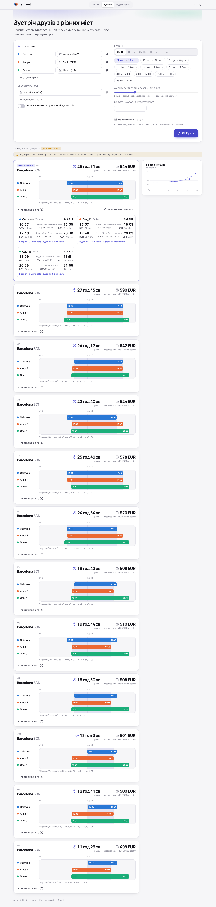

# re:meet

Flight search tuned for **weekends** — and a planner that picks tickets for **friends flying from different cities** so that the time they spend together is maximal. With **price tracking** on top.

| Weekend search | Friends meetup | Price tracking |
|---|---|---|
|  |  |  |

## What it does

- **Weekend search** — pick a weekend (Sat–Sun, Fri–Sun, Fri–Mon, …) and a route. The default *Ideal weekend* preset keeps only flights that leave **no earlier than 08:00** and bring you home **in the evening (17:00–23:30)**. Results get a *comfort score* (time windows, directness, speed) and a composite rank mixing comfort and price. Sort by best / cheapest / fastest / most comfortable.
- **Meetup planner** — add friends with their home airports and one or more candidate meeting cities (optionally the friends' own cities). The engine picks an outbound and a return per friend to **maximise time everyone is in the same place**, trading hours against money with a single knob (*what an hour together is worth*). Shows a timeline of who is there when, the shared window, and a time-vs-price frontier of alternatives. Friends who live in the destination are hosts (no flights).
- **Price tracking** — save any search or meetup query as a *watch*. A scheduler re-runs it, records price history, and raises alerts for **price drops**, **new offers** (flights not seen before), **target price reached**, big rises and vanished offers. Alerts go to the in-app page, a webhook (Slack/Discord/anything) and/or Telegram.
- **Connectors** — Kiwi.com (Tequila), Amadeus Self-Service and Duffel adapters behind one `FlightProvider` interface, queried in parallel, de-duplicated (same flights → cheapest wins) and cached. With no keys configured a deterministic **demo provider** generates realistic synthetic schedules so everything works out of the box (the UI says so).
- UI in Ukrainian and English, light/dark theme, responsive.

## Stack

TypeScript end-to-end · Next.js 16 (App Router, route handlers as the API) · React 19 · Tailwind CSS 4 · Zod · Vitest. No database required: watches live in a JSON file store (`DATA_DIR`), behind a `WatchStore` interface you can swap for Postgres/Redis.

```
src/
  app/                 pages (/, /meetup, /watches) and API routes (/api/*)
  components/          UI: search, meetup (timeline, frontier), watch, primitives
  lib/
    domain/            types, time-zone utils, weekend dates, filters & scoring
    providers/         FlightProvider interface, kiwi / amadeus / duffel / mock, aggregator + cache
    meetup/            the meetup planning engine
    watch/             watch store, checker (diff → alerts), notifiers
    api/               zod schemas
    data/airports.ts   curated airport table (IATA, city, IANA tz, coordinates)
    i18n/              uk / en dictionaries
tests/                 vitest unit tests
```

## Run

```bash
npm install
cp .env.example .env     # optional: add provider keys
npm run dev              # http://localhost:3000
```

`npm test` runs the unit tests, `npm run lint` and `npm run typecheck` do what they say, `npm run build && npm start` for production.

## Configuring connectors

Set any of these in `.env`; configured providers are used, the rest skipped. If none is configured, demo data is served.

| Provider | Variables |
|---|---|
| Kiwi.com Tequila | `KIWI_API_KEY` |
| Amadeus Self-Service | `AMADEUS_CLIENT_ID`, `AMADEUS_CLIENT_SECRET`, `AMADEUS_ENV=test\|production` |
| Duffel | `DUFFEL_ACCESS_TOKEN` |

`PROVIDERS=kiwi,duffel` restricts the set; `PROVIDERS=mock` forces demo data; `INCLUDE_DEMO=1` merges demo data with real results (useful for development).

Adding another vendor = one file implementing `FlightProvider` (`search(req) → Itinerary[]`) and one line in `providers/registry.ts`. Times are stored as local wall-clock strings plus UTC instants; vendors that return local times without offsets are converted with the airport time-zone table.

## Price tracking

Watches are checked either by the in-process scheduler (`WATCH_POLL_MINUTES=30`) or by an external cron hitting `GET|POST /api/watches/check` (protect with `CRON_SECRET`, send `Authorization: Bearer …`). Example Vercel cron in `vercel.json`:

```json
{ "crons": [{ "path": "/api/watches/check", "schedule": "*/30 * * * *" }] }
```

Notifications: per watch, a webhook URL (JSON `{ text, label, alerts }`) and/or a Telegram chat id (needs `TELEGRAM_BOT_TOKEN`).

## API

| Route | Body / params | Returns |
|---|---|---|
| `POST /api/search` | `SearchRequest` (origin, destination, departDate, returnDate?, adults, cabin, currency, filters) | ranked itineraries + per-provider status |
| `POST /api/meetup` | `MeetupRequest` (friends[], destinations[], dates, valuePerHour, filters…) | ranked plans, Pareto frontier, unreachable friends |
| `GET /api/airports?q=` | query | airports |
| `GET/POST /api/watches`, `GET/PATCH/DELETE /api/watches/:id`, `POST /api/watches/:id/check`, `GET/POST /api/watches/check` | | watch CRUD, manual and scheduled checks |

## How the meetup engine works

Time together = `min(return departures) − max(arrivals)`. For a fixed pair of probe times *(T_start, T_end)*, every friend independently takes the cheapest outbound arriving ≤ T_start and the cheapest return departing ≥ T_end, so the problem decomposes: candidate T values are just the actual arrival/departure times in the data, prefix/suffix minima make each lookup O(log n), and the objective `hours × valuePerHour − total price` is evaluated exactly over all pairs. Results are de-duplicated, ranked, and the Pareto frontier (more time ↔ less money) is surfaced so the user can slide between "cheapest" and "longest".
