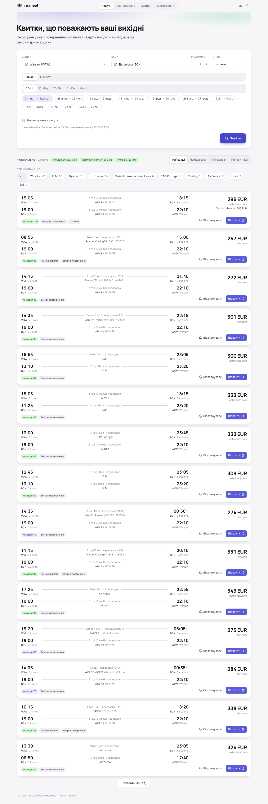
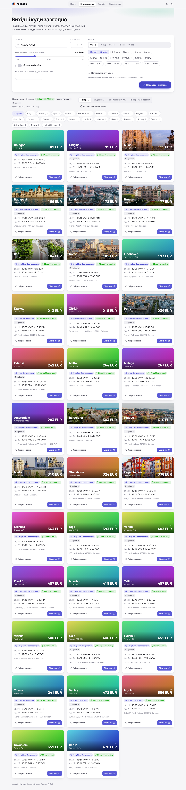
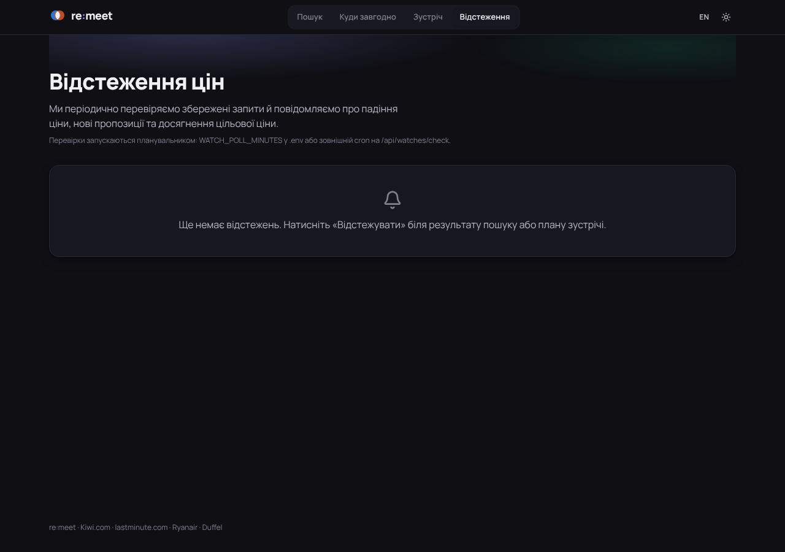

# re:meet

Flight search tuned for **weekends** — and a planner that picks tickets for **friends flying from different cities** so that the time they spend together is maximal. With **price tracking** on top.

| Weekend search | Weekend anywhere | Friends meetup | Price tracking |
|---|---|---|---|
|  |  |  |  |

## What it does

- **Weekend search** — pick a weekend (Sat–Sun, Fri–Sun, Fri–Mon, …) and a route. The default *Ideal weekend* preset keeps only flights that leave **no earlier than 08:00** and bring you home **in the evening (17:00–23:30)**. Results get a *comfort score* (time windows, directness, speed) and a composite rank mixing comfort and price. Sort by best / cheapest / fastest / most comfortable.
- **Meetup planner** — add friends with their home airports and one or more candidate meeting cities (optionally the friends' own cities). The engine picks an outbound and a return per friend to **maximise time everyone is in the same place**, trading hours against money with a single knob (*what an hour together is worth*). Shows a timeline of who is there when, the shared window, and a time-vs-price frontier of alternatives. Friends who live in the destination are hosts (no flights).
- **Price tracking** — save any search or meetup query as a *watch*. A scheduler re-runs it, records price history, and raises alerts for **price drops**, **new offers** (flights not seen before), **target price reached**, big rises and vanished offers. Alerts go to the in-app page, a webhook (Slack/Discord/anything) and/or Telegram.
- **Real flight data without keys** — Kiwi.com and lastminute.com (via their public MCP servers) plus a direct Ryanair connector, queried in parallel, merged across sources with price comparison, and cached. Duffel, Kiwi Tequila and Amadeus adapters are available when you have keys. A deterministic **demo provider** (`PROVIDERS=mock`) generates synthetic schedules for offline development.
- UI in Ukrainian and English, light/dark theme, responsive.

## Stack

TypeScript end-to-end · Next.js 16 (App Router, route handlers as the API) · React 19 · Tailwind CSS 4 · Zod · Vitest. No database required: watches live in a JSON file store (`DATA_DIR`), behind a `WatchStore` interface you can swap for Postgres/Redis.

```
src/
  app/                 pages (/, /meetup, /watches) and API routes (/api/*)
  components/          UI: search, meetup (timeline, frontier), watch, primitives
  lib/
    domain/            types, time-zone utils, weekend dates, filters & scoring
    providers/         FlightProvider interface, kiwi / amadeus / duffel / mock, aggregator + cache
    meetup/            the meetup planning engine
    watch/             watch store, checker (diff → alerts), notifiers
    api/               zod schemas
    data/airports.ts   curated airport table (IATA, city, IANA tz, coordinates)
    i18n/              uk / en dictionaries
tests/                 vitest unit tests
```

## Run

```bash
npm install
cp .env.example .env     # optional: add provider keys
npm run dev              # http://localhost:3000
```

`npm test` runs the unit tests, `npm run lint` and `npm run typecheck` do what they say, `npm run build && npm start` for production.

## Weekend anywhere

`/explore` answers "where can I go this weekend?": pick a departure city, a weekend and the longest flight you accept each way (for example up to 4 hours, connections included). The app asks Kiwi.com for every reachable city ("anywhere", one best option per city, four departure windows, two price pages each), applies the same ideal-weekend windows, and shows one card per destination: price from, flight time, hours on the ground, times, airlines and a photo. Sort by best, cheapest, most time there or shortest flight; filter by country; open the booking, or jump to the regular search for that city with everything prefilled. The whole query can be saved as a price watch: you get alerts on price drops and on new destinations.

API: `POST /api/explore` with `{ origin, departDate, returnDate, maxFlightHours, adults, filters }`.

## Flight sources

Out of the box the app queries three sources in parallel, with **no API keys**:

| Source | Id | What it covers | How |
|---|---|---|---|
| Kiwi.com | `kiwi` | Hundreds of airlines, incl. Ryanair, Wizz Air, easyJet, Vueling, LOT, Lufthansa group, Air France-KLM, and Kiwi's self-transfer combinations | Kiwi.com's public MCP server, `https://mcp.kiwi.com` |
| lastminute.com | `lastminute` | Full-service and low-cost airlines; a second price for the same flights | lastminute.com's official public MCP server, `https://mcp.lastminute.com/mcp` |
| Ryanair | `ryanair` | Every Ryanair-group flight (FR, RK, AL…) directly from the airline | Ryanair's public fare-finder endpoint |

Results are merged: the same trip from several sources becomes one card with the cheapest price, the most detailed flight description (flight numbers, connection airports) and the other sources' prices for comparison. Above the results, an airline filter lists every operating carrier found.

Each MCP source returns at most 15–20 itineraries per call, so the connector splits the day into departure-time windows and queries them in parallel. Ryanair's fare finder returns only the cheapest flight in a time window, so the connector splits the window around every flight it finds until the whole day is listed (about 2n+1 requests for n flights).

Optional sources that need keys:

| Source | Id | Variables | Status (Nov 2026) |
|---|---|---|---|
| Duffel | `duffel` | `DUFFEL_ACCESS_TOKEN` | Open sign-up; test tokens only return the fictional "Duffel Airways", live tokens need account verification |
| Kiwi.com Tequila | `kiwi-tequila` | `KIWI_API_KEY` | Invite-only since 2024 |
| Amadeus | `amadeus` | `AMADEUS_CLIENT_ID`, `AMADEUS_CLIENT_SECRET` | Self-Service portal closed on 17 July 2026; Enterprise contracts only |

`PROVIDERS=kiwi,ryanair` restricts the set; `PROVIDERS=mock` forces demo data; `INCLUDE_DEMO=1` adds demo data next to real results. Each no-key source can be turned off with `KIWI_MCP_ENABLED=0`, `LASTMINUTE_MCP_ENABLED=0`, `RYANAIR_ENABLED=0`.

Adding another source = one file implementing `FlightProvider` (`search(req) → Itinerary[]`) and one line in `providers/registry.ts`.

**Terms of use.** The Kiwi.com and lastminute.com MCP servers are published for AI assistants, and Ryanair's terms restrict automated use of its website by third parties. Fine for personal use and prototyping; for a public or commercial product, agree terms with each company (or use Duffel/partner APIs). Requests are cached for 10 minutes and throttled.

**Behind a proxy.** Node's built-in `fetch` ignores `HTTPS_PROXY` unless started with `NODE_USE_ENV_PROXY=1` (Node ≥ 22.21).

## Price tracking

Watches are checked either by the in-process scheduler (`WATCH_POLL_MINUTES=30`) or by an external cron hitting `GET|POST /api/watches/check` (protect with `CRON_SECRET`, send `Authorization: Bearer …`). Example Vercel cron in `vercel.json`:

```json
{ "crons": [{ "path": "/api/watches/check", "schedule": "*/30 * * * *" }] }
```

Notifications: per watch, a webhook URL (JSON `{ text, label, alerts }`) and/or a Telegram chat id (needs `TELEGRAM_BOT_TOKEN`).

## API

| Route | Body / params | Returns |
|---|---|---|
| `POST /api/search` | `SearchRequest` (origin, destination, departDate, returnDate?, adults, cabin, currency, filters) | ranked itineraries + per-provider status |
| `POST /api/explore` | `ExploreRequest` (origin, dates, maxFlightHours, filters) | destinations grouped by city with best and cheapest option |
| `POST /api/meetup` | `MeetupRequest` (friends[], destinations[], dates, valuePerHour, filters…) | ranked plans, Pareto frontier, unreachable friends |
| `GET /api/airports?q=` | query | airports |
| `GET/POST /api/watches`, `GET/PATCH/DELETE /api/watches/:id`, `POST /api/watches/:id/check`, `GET/POST /api/watches/check` | | watch CRUD, manual and scheduled checks |

## How the meetup engine works

Time together = `min(return departures) − max(arrivals)`. For a fixed pair of probe times *(T_start, T_end)*, every friend independently takes the cheapest outbound arriving ≤ T_start and the cheapest return departing ≥ T_end, so the problem decomposes: candidate T values are just the actual arrival/departure times in the data, prefix/suffix minima make each lookup O(log n), and the objective `hours × valuePerHour − total price` is evaluated exactly over all pairs. Results are de-duplicated, ranked, and the Pareto frontier (more time ↔ less money) is surfaced so the user can slide between "cheapest" and "longest".
